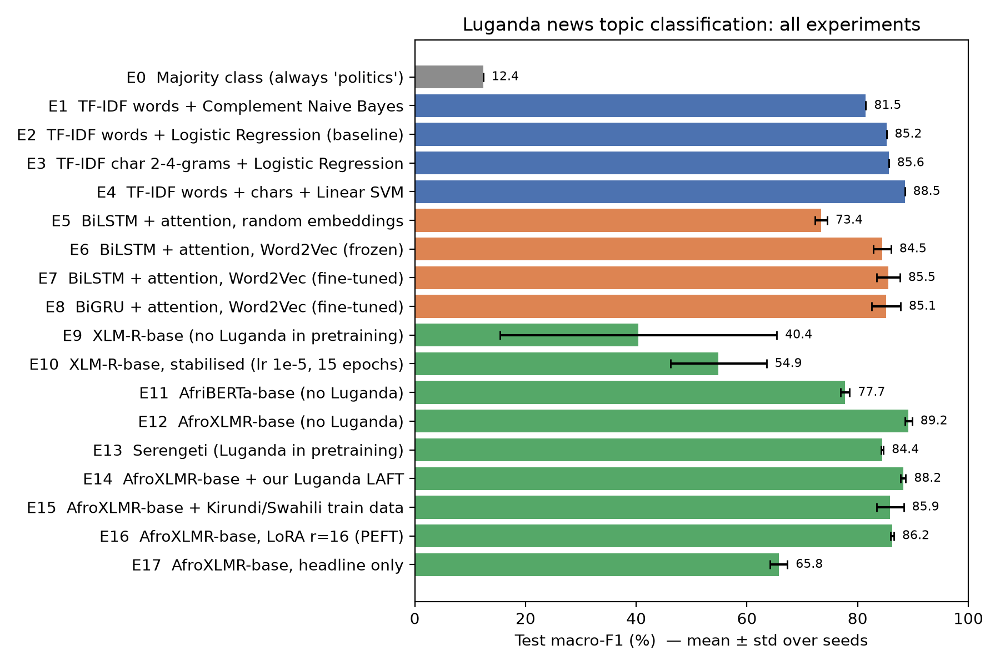
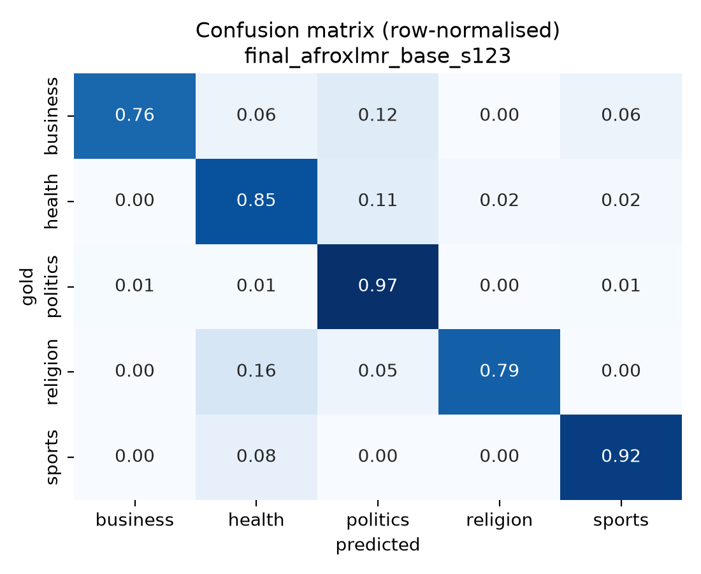
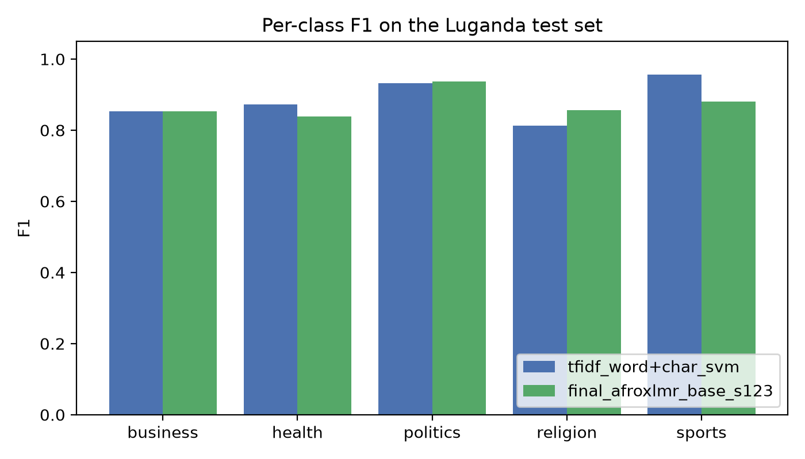

# Luganda News Topic Classification

**Text classification for an African language: automatically assigning Luganda news articles to one of five topics (business, health, politics, religion, sports).**

| | |
|---|---|
| 🌐 **Live demo** | https://huggingface.co/spaces/Burabyo/luganda-news-classifier |
| 🎥 **Demo video** |(https://www.awesomescreenshot.com/video/57557215?key=68113497df1526d8c7b71f877b8fbd2f)|
| 📄 **Report (PDF)** | [`report/report.pdf`](report/report.pdf) |
| 🤗 **Fine-tuned model** | https://huggingface.co/Burabyo/luganda-news-afroxlmr |

---

## 1. Problem

Luganda (Ganda, ISO 639-3 `lug`) is a Bantu language spoken by about 11 million people in central Uganda, including Kampala. It is the most widely used Ugandan language in local media, yet it has almost no labelled NLP data. It is also **absent from the pretraining data of the most widely used African language models** (AfriBERTa covers 11 languages and AfroXLMR-base covers 17; Luganda is in neither).

This project builds and deploys a topic classifier for Luganda news and studies **what works when a language has only 771 labelled examples and was not seen by the pretrained model**:

* **RQ1:** Does African-centric pretraining (AfriBERTa, AfroXLMR) beat massively multilingual pretraining (XLM-R) and strong classical baselines for a language none of them saw?
* **RQ2:** Does exposure to Luganda in pretraining help? This is tested with (a) Serengeti, which includes Luganda, and (b) **our own language-adaptive fine-tuning (LAFT)** of AfroXLMR on 3.9M tokens of filtered Luganda web text.
* **RQ3:** Does labelled news from related Bantu languages (Kirundi, Swahili) help (cross-lingual transfer)?
* **RQ4:** Can parameter-efficient fine-tuning (LoRA) match full fine-tuning?

## 2. Data

| Resource | Use | Size | Licence |
|---|---|---|---|
| [MasakhaNEWS](https://github.com/masakhane-io/masakhane-news) (Adelani et al., 2023), Luganda split | labelled train/dev/test | 771 / 110 / 223 articles, 5 classes | AFL-3.0 |
| MasakhaNEWS Kirundi + Swahili train | cross-lingual experiment (RQ3) | 1,117 + 1,658 articles (filtered to the 5 shared labels) | AFL-3.0 |
| [CC-100](https://data.statmt.org/cc-100/) `lg` (Conneau et al., 2020; Wenzek et al., 2020) | Word2Vec + LAFT (unlabeled) | 315k lines, **43% kept** after Luganda filtering | CC-100 terms |
| Wikipedia `20231101.lg` | Word2Vec + LAFT (unlabeled) | 4,048 articles | CC BY-SA |

Key data properties (from `results/eda.json`): politics makes up 45% of the training set (5.6:1 imbalance); articles average 232 tokens; 63% of word types occur only once; **42% of test word types never appear in training**. That last figure follows from Luganda's agglutinative morphology and makes vocabulary coverage the central challenge. All articles come from a single outlet (gambuuze.ug). No synthetic or LLM-generated data is used.

## 3. Methods

| Family | Models | Key idea |
|---|---|---|
| Classical baselines | Majority; TF-IDF + Naive Bayes / Logistic Regression / Linear SVM; word vs **character n-grams** | Char n-grams share evidence across inflected forms of the same stem |
| Static embeddings + RNN | **BiLSTM / BiGRU + additive attention**, random vs **Word2Vec (skip-gram) trained by us on Luganda** | Pretrained embeddings cut test OOV from 16.3% to 6.6% |
| Transformers (fine-tuned) | XLM-R-base, AfriBERTa-base, AfroXLMR-base, Serengeti | Pretrained multilingual encoders + classification head |
| Adaptation | **LAFT** (masked-LM on Luganda text), **cross-lingual training data**, **LoRA** | Different ways to bring in knowledge without more Luganda labels |

All hyperparameters and checkpoints are selected on the **dev** set, and the test set is scored once. Neural models are run with **3 seeds** (13, 42, 123) and reported as mean ± standard deviation. The primary metric is **macro-F1**, because the classes are imbalanced. Weighted-F1 is also reported so the numbers can be compared with the MasakhaNEWS paper.

## 4. Results

Test set: 223 Luganda articles. Neural models: mean ± std over 3 seeds. All values are percentages.

| ID | Approach | Seeds | Dev macro-F1 | Test accuracy | Test macro-F1 | Test weighted-F1 |
|---|---|---|---|---|---|---|
| E0 | Majority class (always 'politics') | 1 | 12.5 | 44.8 | 12.4 | 27.8 |
| E1 | TF-IDF words + Complement Naive Bayes | 1 | 79.0 | 85.2 | 81.5 | 84.6 |
| E2 | TF-IDF words + Logistic Regression (baseline) | 1 | 82.2 | 87.0 | 85.2 | 87.1 |
| E3 | TF-IDF char 2-4-grams + Logistic Regression | 1 | 89.0 | 87.4 | 85.6 | 87.4 |
| E4 | TF-IDF words + chars + Linear SVM | 1 | 85.2 | 90.1 | 88.5 | 90.0 |
| E5 | BiLSTM + attention, random embeddings | 3 | 69.9 ± 1.2 | 76.1 ± 0.9 | 73.4 ± 1.1 | 77.5 ± 1.0 |
| E6 | BiLSTM + attention, Word2Vec (frozen) | 3 | 89.7 ± 1.4 | 85.9 ± 1.8 | 84.5 ± 1.6 | 86.3 ± 1.8 |
| E7 | BiLSTM + attention, Word2Vec (fine-tuned) | 3 | 90.6 ± 0.6 | 87.4 ± 1.7 | 85.5 ± 2.1 | 87.6 ± 1.5 |
| E8 | BiGRU + attention, Word2Vec (fine-tuned) | 3 | 90.9 ± 1.4 | 87.4 ± 2.2 | 85.1 ± 2.6 | 87.6 ± 2.2 |
| E9 | XLM-R-base (no Luganda in pretraining) | 3 | 42.8 ± 23.8 | 59.0 ± 13.7 | 40.4 ± 25.0 | 51.8 ± 20.4 |
| E10 | XLM-R-base, stabilised (lr 1e-5, 15 epochs) | 3 | 54.3 ± 7.8 | 67.7 ± 4.7 | 54.9 ± 8.7 | 65.7 ± 5.9 |
| E11 | AfriBERTa-base (no Luganda) | 3 | 87.6 ± 0.4 | 82.4 ± 0.6 | 77.7 ± 0.8 | 82.1 ± 0.6 |
| E12 | AfroXLMR-base (no Luganda) | 3 | 83.8 ± 1.7 | 90.9 ± 0.4 | 89.2 ± 0.6 | 90.8 ± 0.4 |
| E13 | Serengeti (Luganda in pretraining) | 3 | 89.1 ± 2.6 | 86.4 ± 0.8 | 84.4 ± 0.2 | 86.2 ± 0.6 |
| E14 | AfroXLMR-base + our Luganda LAFT | 3 | 87.6 ± 0.7 | 90.1 ± 0.6 | 88.2 ± 0.5 | 90.1 ± 0.5 |
| E15 | AfroXLMR-base + Kirundi/Swahili train data | 3 | 91.6 ± 1.4 | 88.2 ± 1.4 | 85.9 ± 2.4 | 88.0 ± 1.5 |
| E16 | AfroXLMR-base, LoRA r=16 (PEFT) | 3 | 85.9 ± 0.9 | 88.0 ± 0.2 | 86.2 ± 0.3 | 87.8 ± 0.3 |
| E17 | AfroXLMR-base, headline only | 3 | 60.3 ± 2.5 | 72.3 ± 0.9 | 65.8 ± 1.5 | 70.7 ± 1.5 |



Figures are in [`results/figures/`](results/figures). Full per-class reports and confusion matrices for every run are in [`results/runs/`](results/runs).

### Key findings

1. **Classical baselines are strong.** The word+character TF-IDF SVM reaches 88.5 macro-F1. Character n-grams help because Luganda is agglutinative: inflected forms of the same stem share sub-word features.
2. **Pretrained Luganda embeddings matter for RNNs.** Word2Vec trained on our filtered Luganda corpus lifts the BiLSTM from 73.4 to 85.5 and cuts test OOV from 16.3% to 6.6%.
3. **African-centric adaptation is decisive (RQ1).** AfroXLMR-base is the best model (89.2 ± 0.6 macro-F1, 90.9% accuracy) even though it never saw Luganda. XLM-R-base has the same architecture but is unstable on Luganda (40–55). AfriBERTa (77.7) suffers from heavy truncation: 2.8 subwords per word means 97% of articles exceed 256 tokens.
4. **Seeing Luganda in pretraining is not enough by itself (RQ2).** Serengeti, which includes Luganda, reaches 84.4. Our own LAFT halves Luganda masked-LM perplexity (15.8 → 8.3) and stabilises fine-tuning (dev 87.6 vs. 83.8), but test macro-F1 stays at 88.2: better language modelling did not translate into better topic classification.
5. **Pooling related-language data hurt (RQ3)** (85.9): 76% of the training data became non-Luganda.
6. **LoRA (RQ4)** reaches 86.2 while training 0.42% of the parameters.
7. **Headlines alone are insufficient** (65.8): most topic evidence is in the article body.

### Error analysis (deployed AfroXLMR-base model, 24 errors / 223)

Most errors fall into a few groups: genuinely multi-topic articles (e.g. *"Uganda Airlines suspends flights because of Coronavirus"*, labelled business and predicted health); probable label noise; names and Buganda-kingdom vocabulary shared across topics (the name of Buganda's sports minister, *Ssekabembe*, pulls articles towards sports); and event words such as *hospital* in religion stories. Accuracy falls for long (truncated) articles and for articles with many unseen words, and the model is strongly over-confident (0.93 mean confidence on its errors). Details: `results/error_analysis.json`, `results/misclassified_*.csv` and Section 6 of the report.

| Confusion matrix (AfroXLMR-base) | Per-class F1 vs. baseline |
|---|---|
|  |  |


## 5. Repository layout

```
├── src/
│   ├── data.py              # loading, normalisation, splits (shared by every model)
│   ├── metrics.py           # macro/weighted F1, per-class report, confusion matrix, run logging
│   ├── eda.py               # dataset statistics + figures
│   ├── baselines.py         # majority, TF-IDF + NB / LR / SVM (word & char n-grams)
│   ├── word2vec_train.py    # CC-100/Wikipedia Luganda filtering, leakage check, skip-gram training
│   ├── rnn.py               # BiLSTM / BiGRU + attention (PyTorch)
│   ├── transformer_ft.py    # fine-tuning loop (full FT, LoRA, cross-lingual data, headline ablation)
│   ├── laft.py              # language-adaptive MLM fine-tuning on Luganda
│   ├── aggregate_results.py # experiment table + figure
│   ├── error_analysis.py    # confusion matrices, error buckets, misclassified examples
│   └── export_onnx.py       # ONNX export + int8 quantisation + accuracy check of the deployed model
├── space/index.html         # deployed web app: runs the 8-bit ONNX model in the browser (Transformers.js)
├── app/app.py               # Gradio version for local use (full model, word-level explanations, baseline)
├── scripts/               # download_models.sh, publish_hf.py
├── run_experiments.sh       # reproduces everything end-to-end
├── data/raw/                # MasakhaNEWS lug/run/swa TSVs (official splits)
├── results/                 # eda.json, runs/*.json, experiments.md/csv, figures/, error analysis
├── report/                  # final report (PDF + HTML source)
└── docs/                    # video script, viva preparation
```

## 6. Reproducing

```bash
python3 -m venv .venv && source .venv/bin/activate
pip install -r requirements.txt
# unlabeled Luganda text for Word2Vec / LAFT (~40 MB)
mkdir -p data/unlabeled
curl -L https://data.statmt.org/cc-100/lg.txt.xz | xz -d > data/unlabeled/cc100_lg.txt
curl -L -o data/unlabeled/wiki_lg.parquet https://huggingface.co/datasets/wikimedia/wikipedia/resolve/main/20231101.lg/train-00000-of-00001.parquet
bash run_experiments.sh          # ~8-10 h on an Apple M-series laptop (MPS); faster on a CUDA GPU
```

Individual stages can be run on their own, for example `python src/baselines.py` (about 1 minute) or `python src/transformer_ft.py --model Davlan/afro-xlmr-base --name afroxlmr_base --seeds 42`.

### Deployment

The live demo is a **static Hugging Face Space** that runs the model **in the visitor's browser**: free Hugging Face hosting no longer supports server-side Gradio apps. The pipeline:

```bash
python src/transformer_ft.py --model models/pretrained/Davlan__afro-xlmr-base --name final_afroxlmr_base --seeds 123 --save best
python src/export_onnx.py        # -> models/best/onnx/model_quantized.onnx (1,112 MB -> 279 MB, same test accuracy)
python scripts/publish_hf.py     # uploads the model + space/index.html
```

| Deployed model (test set) | Size | Accuracy | Macro-F1 | Agreement with PyTorch |
|---|---|---|---|---|
| PyTorch fp32 | 1,112 MB | 89.2 | 87.3 | — |
| ONNX int8 (in browser) | 279 MB | 89.2 | 87.4 | 96.9% |

The browser app applies the same text normalisation as training, shows topic probabilities, highlights which sentences drove the prediction (occlusion), and warns when confidence is below 60%.

**Local Gradio version** (full-precision model, word-level explanations, TF-IDF baseline side by side):

```bash
pip install gradio
python app/app.py                # http://127.0.0.1:7860  (loads models/best, or the Hub model if absent)
```

## 7. Existing resources vs. own work

**Used (not ours):** the MasakhaNEWS dataset; CC-100 and Wikipedia text; the pretrained checkpoints XLM-R, AfriBERTa, AfroXLMR and Serengeti; and PyTorch, Hugging Face Transformers, PEFT, scikit-learn, gensim and Gradio.

**Implemented in this project:** text normalisation for Luganda orthography; a Luganda language filter for web text and a test-leakage check; Word2Vec training; the BiLSTM/BiGRU-attention model and its training loop; the transformer fine-tuning loop; language-adaptive pretraining; the cross-lingual, LoRA and input-ablation experiments; multi-seed evaluation, aggregation and error analysis; and the web application (occlusion-based word importance, low-confidence warning, baseline comparison).

## 8. References

See the reference list in the report. Key sources: Adelani et al. (2023) *MasakhaNEWS*; Ogueji et al. (2021) *AfriBERTa*; Alabi et al. (2022) *AfroXLMR / MAFT*; Adebara et al. (2023) *SERENGETI*; Conneau et al. (2020) *XLM-R*; Kreutzer et al. (2022) *Quality at a Glance*; Hu et al. (2022) *LoRA*; Mikolov et al. (2013) *Word2Vec*.
